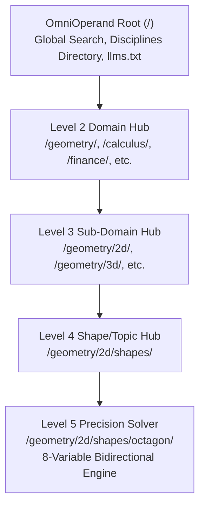

# AGENTS.md — OmniOperand Architecture & AI Engineering Mandates

> Production Architecture, Mathematical Precision Standards & Operational Protocols for `enmuse/omnioperand`  
> Domain: **omnioperand.com**  
> Operational Lead: **Brandon** (Hendersonville, NC)

---

## 1. Executive Summary & Vision

**OmniOperand** (`omnioperand.com`) is a high-authority computational platform engineered for students, engineers, researchers, and autonomous AI agents. Unlike legacy calculation websites that feature static one-way inputs, outdated UI, and intrusive advertisements, OmniOperand provides:

1. **Unified Bidirectional Solvers:** Enter *any* single known parameter (or combination of parameters), and the mathematical engine instantaneously resolves all other variables with machine precision.
2. **Exact Analytical & Radical Derivations:** Numerical answers are always paired with exact closed-form radical representations (e.g. $2(1+\sqrt{2})a^2$) and step-by-step algebraic proofs.
3. **Live Interactive Cartesian Blueprints:** Dynamic SVG rendering on a coordinate plane with responsive dimension lines, vertex callouts, and tactile feedback.
4. **Native AI Agent Integration (`llms.txt`):** Structured system prompts, prompt engineering rubrics, and machine-readable endpoints eliminating hallucination for LLMs (ChatGPT, Claude, Gemini).
5. **100/100 Google PageSpeed Mandate:** Zero render-blocking frameworks, zero external font round-trips, sub-50ms TTFB on Cloudflare's global edge network.



---

## 2. Directory Layout & Architecture

```text
/
├── .env                              # Cloudflare, GitHub, and PageSpeed API credentials (Git-ignored)
├── .gitignore                        # Git exclusion rules
├── AGENTS.md                         # AI agent system memory & operational mandates (this file)
├── HUMAN.md                          # Human operator action punch list for Brandon
├── README.md                         # Public repository overview
├── 404.html                          # Mathematical 404 error page
├── index.html                        # Homepage & global discipline explorer
├── robots.txt                        # Search engine and AI crawler directives
├── sitemap.xml                       # Canonical XML sitemap
├── llms.txt                          # Standardized AI agent manifest (Answer.AI spec)
├── llms-full.txt                     # Comprehensive mathematical knowledge base for LLMs
├── assets/
│   ├── css/
│   │   ├── omni-core.css             # Math design system (glassmorphism, typography, grid)
│   │   └── calculator.css           # Calculator HUD, parameter cards, sliders, SVG canvas
│   └── js/
│       ├── omni-search.js            # Client-side fuzzy search & theme management
│       └── octagon-solver.js         # Flagship regular octagon 8-variable bidirectional solver
├── geometry/
│   ├── index.html                    # Level 2 Hub: Geometry & Spatial Analysis
│   └── 2d/
│       ├── index.html                # Level 3 Hub: Two-Dimensional Geometry
│       └── shapes/
│           ├── index.html            # Level 4 Hub: Polygons & Shapes Directory
│           └── octagon/
│               └── index.html        # Level 5 Tool: Regular Octagon Calculator & Proofs
├── calculus/
│   └── index.html                    # Level 2 Hub: Calculus & Mathematical Analysis
├── finance/
│   └── index.html                    # Level 2 Hub: Quantitative Finance & Actuarial Math
├── physics/
│   └── index.html                    # Level 2 Hub: Physics & Engineering Mechanics
├── statistics/
│   └── index.html                    # Level 2 Hub: Probability & Statistics
└── scripts/
    ├── generate_calculators.py       # Programmatic generator & taxonomy builder
    ├── deploy.py                     # Programmatic Cloudflare Pages deployment script
    └── test_site.py                  # Automated test suite (formula invariants, SEO, file integrity)
```

---

## 3. Core Architectural & Engineering Standards

### 1. Bidirectional Solver Philosophy (Never Silo Inputs)
- **Do NOT create fragmented one-way pages** (e.g. separate pages for "octagon area from side" and "octagon side from area"). This creates thin doorway pages vulnerable to Google penalties.
- **Implement a Master Bidirectional Solver Matrix:** Every parameter card is interactive. Selecting any variable immediately computes all other variables through algebraic inversions.
- Provide deep semantic anchor IDs (`#area-from-side`, `#diagonals`, `#apothem`, etc.) and structured FAQ blocks so targeted search queries land directly on relevant explanations.

### 2. Mathematical Rigor & Proof Structure
Every single calculation page MUST provide:
- Exact closed-form formulas with irrational radicals ($\sqrt{2}, \sqrt{3}, \pi, \phi$) before decimal rounding.
- Minimum 4 decimal digits of precision by default, configurable up to 10 decimal digits.
- Step-by-step proofs covering:
  - Coordinate definitions and symmetry groups (e.g. $D_8$).
  - Angle derivations (interior, exterior, central).
  - Multiple distinct area derivations (triangulation, bounding square subtraction, radius/apothem forms).
  - Law of Cosines proofs for all diagonal congruence classes.
  - Practical carpentry/engineering heuristics (e.g. miter saw angles, corner cutoff distances).

### 3. SEO & Structured Data Requirements
Every calculator and hub page MUST include:
- A descriptive, keyword-rich `<title>` and `<meta name="description">`.
- Canonical link `<link rel="canonical" href="https://omnioperand.com/...">`.
- Fully populated OpenGraph and Twitter cards.
- Complete Schema.org JSON-LD tags:
  - `WebApplication` (defining inputs, outputs, application category).
  - `BreadcrumbList` (tracking complete hierarchy back to root).
  - `FAQPage` (high-intent question-and-answer pairs matching organic search queries).

### 4. 100/100 PageSpeed & Performance Guardrail
- **Zero Heavy JavaScript Frameworks:** No React, Next.js, Vue, or heavy charting libraries.
- **Zero External Font Calls:** Do NOT import Google Fonts or external webfonts. Use the native mathematical system font stack:
  `-apple-system, BlinkMacSystemFont, "Segoe UI", Roboto, "Helvetica Neue", "JetBrains Mono", Consolas, monospace;`
- **Pure SVG Blueprints:** Technical diagrams and dimension callouts must use responsive, lightweight vector SVGs.

### 5. AI Agent & LLM Native Directives (`llms.txt`)
- Always maintain root `/llms.txt` and `/llms-full.txt`.
- Every calculator must include a copyable "Prompt for LLMs" with explicit system directives and verification checks so users can feed verified problem context into ChatGPT, Claude, and Gemini without hallucination.

---

## 4. Operational Scripts & Automation

All operations are automated via Python scripts in `/scripts/`:

| Script | Purpose | Command |
| :--- | :--- | :--- |
| `scripts/test_site.py` | Validates mathematical invariants, file integrity, and SEO tags | `python3 scripts/test_site.py` |
| `scripts/generate_calculators.py` | Manages taxonomy registry, regenerates sitemap.xml and llms.txt | `python3 scripts/generate_calculators.py --build-all` |
| `scripts/deploy.py` | Deploys site to Cloudflare Pages edge network | `python3 scripts/deploy.py` |

---

## 5. Git & Cloudflare Workflow Protocol

1. **Commit Hygiene:** Use conventional commit messages (`feat:`, `fix:`, `docs:`, `perf:`).
2. **Pre-commit Verification:** Always run `python3 scripts/test_site.py` to ensure all mathematical invariants and file checks pass before pushing.
3. **Deployment:** Push to GitHub remote `origin/main` (`enmuse/omnioperand`) and trigger Cloudflare Pages deployment via `scripts/deploy.py`.
